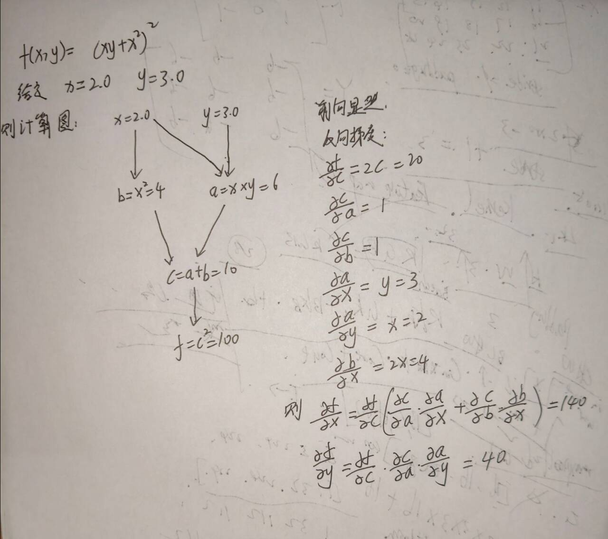
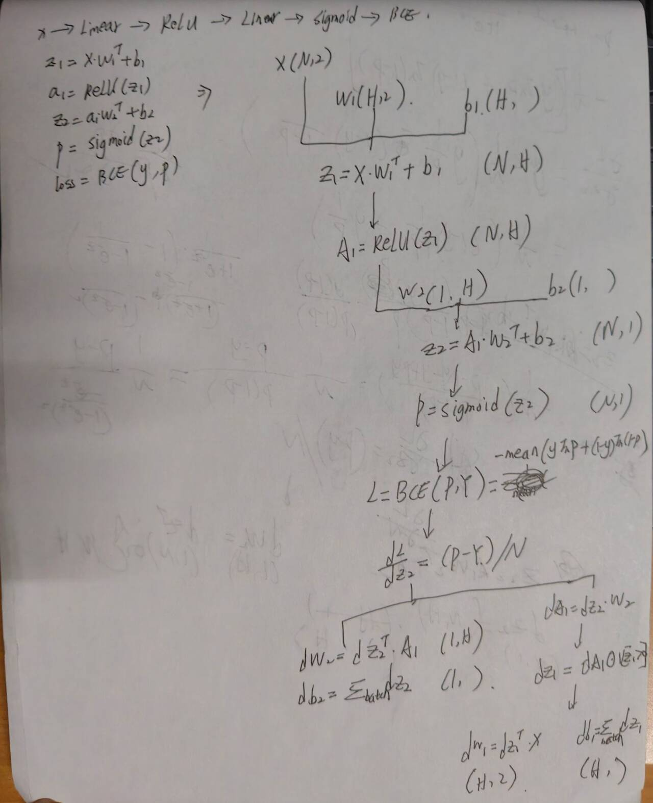
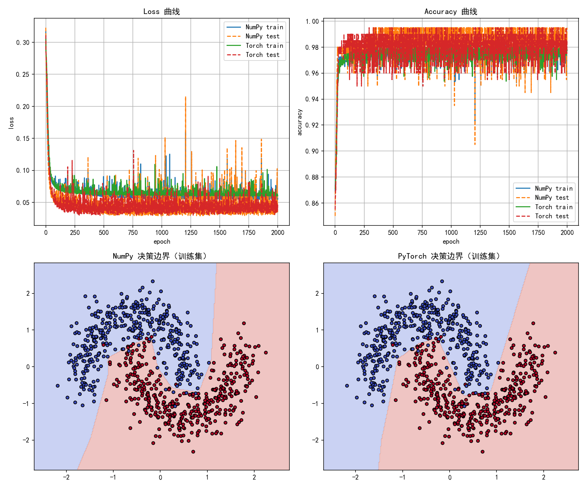

# Task 3：`loss.backward()` —— 计算图与手写反向传播

---

## 0. 提交内容与运行方式

### 0.1 文件清单

| 文件 | 说明 | 本次运行是否产生                               |
| --- | --- |----------------------------------------|
| `practice1.py` | 实践 1：`f(x,y)=(xy+x²)²` 的 NumPy 前向/反向 + PyTorch autograd 对照 | -                                      |
| `practice2.py` | 实践 2：两层二分类网络（Linear→ReLU→Linear→Sigmoid→BCE）的 NumPy 手写反传 + 逐张量对比 | -                                      |
| `extension.py` | 拓展：反传 + SGD 在完整 make_moons 上训练，与 PyTorch 同结构网络比较 | 生成 `output/extension_result.png`（4 子图） |
| `answers.md` | 本文档 | —                                      |
| `output_log.txt` | 三个脚本的**完整真实运行输出** | —                                      |
| `output/comp_graph_practice1_photo.png` | 实践 1 手写推导 | -                                      |
| `output/comp_graph_practice2_photo.jpg` | 实践 2 计算图与反向公式手写原稿 | -                                      |
| `output/extension_result.png` | 拓展的训练曲线 + 两个决策边界 | `extension.py`                         |

三个脚本**互不依赖**（`extension.py` 自带一份 NumPy 前向/反向实现，**不** import `practice2`），
可以任意单独运行、单独复现

### 0.2 运行方式

三个脚本都不需要命令行参数，也不依赖当前工作目录（`practice1/2` 不写文件，`extension.py` 写的是相对路径
`output/extension_result.png`，所以要在**项目根目录**下运行 `extension.py`，`output/` 目录需已存在）。

### 0.3 运行环境

`output_log.txt` 由下面这套环境产出：

| 组件 | 版本 |
| --- | --- |
| Python | 3.13.11 |
| NumPy | 2.4.2 |
| PyTorch | 2.10.0+cu130 |
| scikit-learn | 1.8.0 |
| matplotlib | 3.10.8 |

### 0.4 图片清单（全部位于 `output/`）

| 图 | 内容 | 由谁生成 |
| --- | --- | --- |
| `output/comp_graph_practice1_photo.png` | 实践 1：前向图（x=2.0, y=3.0 → b=x²=4, a=xy=6 → c=a+b=10 → f=c²=100）与逐项偏导、两条路径相加 | 手写拍摄 |
| `output/comp_graph_practice2_photo.jpg` | 实践 2：网络结构（Linear→ReLU→Linear→Sigmoid→BCE）、各张量形状、`dL/dZ2=(P-Y)/N` 之后的整条反向链 | 手写拍摄 |
| `output/extension_result.png` | 左上 Loss 曲线、右上 Accuracy 曲线、左下 NumPy 决策边界、右下 PyTorch 决策边界 | `extension.py` |

---

# 实践 1：简单计算链

## 1.1 目标与取值

$$f(x,y) = (xy + x^2)^2,\qquad x = 2.0,\quad y = 3.0$$

## 1.2 前向：拆成 4 个基本算子

代码（`practice1.py` 第 8–12 行）：

```python
a = x * y      # mul
b = x ** 2     # square（x 在这里被"再用一次"）
c = a + b      # add
f = c ** 2     # square
```

`output_log.txt` 里 practice1 部分的真实输出：

```
NumPy 前向：
a = 6.0
b = 4.0
c = 10.0
f = 100.0
```

即 `a = 2×3 = 6`、`b = 2² = 4`、`c = 6+4 = 10`、`f = 10² = 100`。

手写稿画出的计算图（`output/comp_graph_practice1_photo.png`）：



其中标注的局部导数为：`∂f/∂c = 2c = 20`、`∂c/∂a = 1`、`∂c/∂b = 1`、`∂a/∂x = y = 3`、
`∂a/∂y = x = 2`、`∂b/∂x = 2x = 4`，最后两行写明 `∂f/∂x = 140`、`∂f/∂y = 40`。

## 1.3 反向：从后往前，每步乘以本算子的局部导数

代码（`practice1.py` 第 21–29 行）：

```python
df_dc = 2 * c                                  # = 20.0
dc_da, dc_db = 1.0, 1.0                        # 加法：梯度原样分发
da_dx, da_dy, db_dx = y, x, 2 * x              # = 3.0, 2.0, 4.0

df_dx = df_dc * (dc_da * da_dx + dc_db * db_dx)   # ← 注意括号里的"加"
df_dy = df_dc * (dc_da * da_dy)
```

逐步展开：

| 步 | 量 | 推导 | 数值 |
| --- | --- | --- | --- |
| ① | `df/dc` | `2c` | 20.0 |
| ② | `df/da` | `df/dc · dc/da = 20×1` | 20.0 |
| ② | `df/db` | `df/dc · dc/db = 20×1` | 20.0 |
| ③ | `df/dy` | `df/da · da/dy = 20×2` | **40.0** |
| ③ | 路径 a→x | `df/da · da/dx = 20×3` | 60.0 |
| ③ | 路径 b→x | `df/db · db/dx = 20×4` | 80.0 |
| ④ | `df/dx` | `60 + 80`（**两条路径在 x 处汇合，梯度相加**） | **140.0** |

## 1.4 与 autograd 对照

`practice1.py` 用完全相同的算式搭了一张 PyTorch 图并 `backward()`：

```python
x_t = torch.tensor(x, dtype=torch.float64, requires_grad=True)
y_t = torch.tensor(y, dtype=torch.float64, requires_grad=True)
a_t = x_t * y_t
b_t = x_t ** 2
c_t = a_t + b_t
f_t = c_t ** 2
f_t.backward()
```

`output_log.txt` 的真实输出：

```
NumPy 手算梯度：
df/dx = 140.0
df/dy = 40.0

PyTorch autograd 梯度：
df/dx = 140.0
df/dy = 40.0

误差：
x 误差 = 0.0
y 误差 = 0.0
```

`x 误差 = 0.0` 和 `y 误差 = 0.0` 是**精确的 0**（Python 浮点打印为 `0.0`）

解析解也一致：令 `u = xy + x² = 10`，则 `∂f/∂x = 2u(y+2x) = 20×7 = 140`，`∂f/∂y = 2u·x = 20×2 = 40`。

**形状说明**：`x`、`y` 是 Python 标量（0 维），所以 `a,b,c,f` 的形状都是 `()`，
`f_t.grad_fn = PowBackward0`；若写成 `np.array([2.0])`，所有形状变成 `(1,)`，公式完全不变——
标量只是 `shape=()` 的特例。

---

# 实践 2：神经网络的梯度

## 2.1 网络、数据与形状约定

```
X → Linear → ReLU → Linear → Sigmoid → BCE Loss
```

**数据**（`practice2.py` 第 110–113 行）：

```python
X_all, y_all = make_moons(n_samples=200, noise=0.2, random_state=42)
X_all = X_all.astype(np.float64)
y_all = y_all.astype(np.float64).reshape(-1, 1)      # ← 关键：(N,1) 而不是 (N,)
```

只做**一次前向 + 一次反向**，不更新参数、不训练；先取单样本 `N = 1`，再取小 batch `N = 8`（都是数据前几行）。
`Y` 一开始就 `reshape(-1,1)` 成 `(N,1)`，这为了避免 §2.4 里那个"不报错但算错"的广播坑。

**参数初始化**（第 115–122 行）：`D=2, H=4`，

```python
W1 = np.random.randn(H, D) * 0.5   # (4, 2)
b1 = np.zeros((1, H))              # (1, 4)
W2 = np.random.randn(1, H) * 0.5   # (1, 4)
b2 = np.zeros((1, 1))              # (1, 1)
```

`np.random.seed(42)` / `torch.manual_seed(42)` 只影响初始化与前向，不影响结论。

`output_log.txt` 打印的形状：

```
参数形状：
X:  (N, 2)
W1: (4, 2)
b1: (1, 4)
W2: (1, 4)
b2: (1, 1)
中间结果形状：z1=(N,H), a1=(N,H), z2=(N,1), p=(N,1), loss=标量
```

**前向代码**（第 24–33 行）：

```python
N = X.shape[0]
z1 = X @ W1.T + b1          # (N,2)@(2,H) + (1,H) -> (N,H)
a1 = np.maximum(0.0, z1)    # ReLU
z2 = a1 @ W2.T + b2         # (N,H)@(H,1) + (1,1) -> (N,1)
p  = sigmoid(z2)            # (N,1)

eps = 1e-12
loss = -np.mean(y * np.log(p + eps) + (1.0 - y) * np.log(1.0 - p + eps))
```

- `sigmoid` 就是最朴素的 `1.0 / (1.0 + np.exp(-z))`（第 9–10 行）；
  本例的 `|z2|` 都在 1 以内，`exp` 不会溢出（如果换成很深的 logit，就该用分支写法或
  `binary_cross_entropy_with_logits` 了）。
- BCE 里加 `eps = 1e-12` 再取对数，避免 `log(0) = -inf`。

## 2.2 计算图

（`output/comp_graph_practice2_photo.jpg`）把这张图与整条反向链都写下来了：




## 2.3 反向：逐项推导

记 `N` 为 batch size，`loss` 对 batch 取平均（`np.mean`）。

### ① Sigmoid + BCE 的复合梯度

对单个样本记 `ℓ = −[y ln p + (1−y) ln(1−p)]`：

$$\frac{\partial \ell}{\partial p} = -\left(\frac{y}{p} - \frac{1-y}{1-p}\right) = \frac{p-y}{p(1-p)},\qquad \frac{\partial p}{\partial z_2} = p(1-p)$$

两者相乘，`p(1−p)` **正好约掉**：

$$\frac{\partial \ell}{\partial z_2} = \frac{p-y}{p(1-p)}\cdot p(1-p) = p - y$$

`np.mean` 再把 `1/N` 带上：

$$\boxed{\frac{\partial L}{\partial Z_2} = \frac{P - Y}{N}}$$

### ② 线性层的"三件套"

对任意线性层 `Z = A·Wᵀ + b`（`A:(N,in)`，`W:(out,in)`，`Z:(N,out)`）：

$$\frac{\partial L}{\partial W} = \left(\frac{\partial L}{\partial Z}\right)^{\!\top} A,\qquad
\frac{\partial L}{\partial b} = \sum_{\text{batch}} \frac{\partial L}{\partial Z},\qquad
\frac{\partial L}{\partial A} = \frac{\partial L}{\partial Z}\, W$$

> **偏置求和？** `b` 的形状是 `(1,out)`，前向时被**广播**加到了 `(N,out)` 的每一行上。
> 反向时要"反广播"：`b` 的每个分量都参与了 N 次加法，所以梯度必须在 batch 维上求和
> （`axis=0`）。

### ③ ReLU

$$\frac{\partial L}{\partial Z_1} = \frac{\partial L}{\partial A_1}\odot\mathbb{1}[Z_1 > 0]$$

代码里就是 `dz1 = da1 * (z1 > 0.0)`：`z1 > 0` 得到布尔数组，与 float 相乘自动变成 0/1 掩码。
（`z1 = 0` 处导数取 0，与 PyTorch 的 `relu` 一致。）

### 完整反向流程（对应 `practice2.py` 第 36–44 行）

| 步 | 公式 | 形状 |
| --- | --- | --- |
| ① | `dz2 = (p - y) / N` | `(N,1)` |
| ② | `dW2 = dz2ᵀ @ a1` | `(1,4)` |
| ② | `db2 = Σ_batch dz2` | `(1,1)` |
| ② | `da1 = dz2 @ W2` | `(N,4)` |
| ③ | `dz1 = da1 ⊙ 1[z1>0]` | `(N,4)` |
| ④ | `dW1 = dz1ᵀ @ X` | `(4,2)` |
| ④ | `db1 = Σ_batch dz1` | `(1,4)` |

## 2.4 实验结果：N=1 与 N=8

### （a）N = 1

```
loss NumPy:   0.678811266877165
loss PyTorch: 0.678811266877165
```

四个梯度张量（`output_log.txt` ，两边数值逐位相同）：

```
dW1 NumPy   = [[ 0.          0.        ]
               [ 0.          0.        ]
               [ 0.12638721 -0.00482906]
               [ 0.          0.        ]]
dW1 PyTorch = [[-0.          0.        ]
               [-0.          0.        ]
               [ 0.12638721 -0.00482906]
               [-0.          0.        ]]
db1 NumPy   = [[ 0.          0.         -0.11418158  0.        ]]
dW2 NumPy   = [[0.         0.         0.06142047 0.        ]]
db2 NumPy   = [[0.49278042]]
p           = [[0.49278042]]
```

误差表：

| 量 | 形状 | 最大绝对误差 | 判定 |
| --- | --- | --- | --- |
| `p` | `(1,1)` | `0.0` | 一致 ✓ |
| `dW1` | `(4,2)` | `2.491895578771164e-13` | 一致 ✓ |
| `db1` | `(1,4)` | `2.2512547381836612e-13` | 一致 ✓ |
| `dW2` | `(1,4)` | `1.2109757641098895e-13` | 一致 ✓ |
| `db2` | `(1,1)` | `9.715561688494745e-13` | 一致 ✓ |

### （b）N = 8

```
loss NumPy:   0.7241745639059421
loss PyTorch: 0.724174563905942      ← 只差最后一位（1e-16 量级）
```

```
p =
[[0.49278042]      dW1 = [[ 0.0277832  -0.0169354 ]
 [0.47833995]             [-0.04560212  0.03438197]
 [0.49120764]             [ 0.0157984  -0.00060363]
 [0.44700562]             [ 0.0275616  -0.01680032]]
 [0.49195635]
 [0.4955536 ]      db1 = [[ 0.03396258 -0.02140521 -0.0142727   0.03369169]]
 [0.52623152]
 [0.43846945]]     dW2 = [[-0.03438286  0.04207608  0.00767756 -0.06577308]]
                   db2 = [[-0.01730693]]
```

| 量 | 最大绝对误差 | 判定 |
| --- | --- | --- |
| `p` | `0.0` | 一致 ✓ |
| `dW1` | `1.0764306113131283e-13` | 一致 ✓ |
| `db1` | `7.880501806667439e-14` | 一致 ✓ |
| `dW2` | `1.7372214777822137e-13` | 一致 ✓ |
| `db2` | `7.541189894766376e-14` | 一致 ✓ |

**这批误差全部落在 `1e-13 ~ 1e-12`**，而判定阈值是 `atol=1e-8`——两者差了 5 个数量级，
所以脚本每一行都打印 `是否一致: True`。

---

# 趁热打铁

## Q1. 前向传播为什么要保存每一层的输入/输出？反向在哪里用到？和显存的关系？

**为什么**：每个算子的"局部导数"都依赖它前向时的输入（有时还有输出）。
反向时算子已经"算过去了"，必须回头看当时的数据。具体到本作业：

| 算子 | 反向需要的东西 | 用在哪一行 |
| --- | --- | --- |
| Sigmoid + BCE | 输出 `p` 和标签 `y` | `dz2 = (p - y) / N` |
| 第二个 Linear | 输入 `a1`、权重 `W2` | `dW2 = dz2ᵀ @ a1`；`da1 = dz2 @ W2` |
| ReLU | 输入 `z1`（的符号） | `dz1 = da1 * (z1 > 0.0)` |
| 第一个 Linear | 输入 `X`、权重 `W1` | `dW1 = dz1ᵀ @ X` |

此显式可见的：`numpy_forward_backward` 把 `z1, a1, z2, p` 都算在同一个函数里，
反向直接用这些局部变量——这就是"前向存、反向用"的最小实现。
`extension.py` 把它写得更明确：`numpy_forward(...)` 返回 `cache = (X, y, z1, a1, z2, p)`，
`numpy_backward(cache, W2)` 再把它接回去；PyTorch 的做法则是每个算子用 `ctx.save_for_backward(...)`
存下这些张量，并在输出上挂一个 `grad_fn`

**和显存的关系**：

- 这些被保存的张量在反向传播结束前**都不能释放**。所以激活显存 ≈ `O(N × Σ 各层宽度)`，
  通常**远大于参数量**。`practice2.py` 里 `H=4`、只跑 `N=8` 的小 batch，规模可以忽略；
  但 `extension.py` 里 `N=800, H=16`，一次前向就有 `800 × (16+16+1+1) = 27200` 个数要留着，
  而参数只有 `16×2 + 16 + 1×16 + 1 = 65` 个数——**差了约 400 倍**。

- 它随 batch size **线性增长**（`extension.py` 里 `batch_size=64`，激活量就是 batch=8 时的 8 倍）
- 推理时用 `with torch.no_grad():`（见 `extension.py` 第 202 行）不建图、不缓存，所以省显存也更快。
- `loss.backward()` **默认会把图释放掉**，说明这些缓存的生命周期就是"到反向传播为止"；
  需要二次反传必须显式 `retain_graph=True`。
- 显存不够时可以用 **gradient checkpointing**：前向只存少数"检查点"，反向时把中间结果重算一遍，用计算换显存。

## Q2. 链式法则怎样把损失梯度传回第一层权重？结合计算图说明

把计算图想成一条"乘法链"，反向传播就是**从 loss 出发、每经过一个算子就乘以它的局部导数**，
种子是 `dL/dL = 1`：

```
loss ──①(BCE+Sigmoid)──▶ dz2   (N,1)  = (p - y)/N
     ──②(Linear2)──────▶ da1   (N,4)  = dz2 @ W2
     ──③(ReLU)─────────▶ dz1   (N,4)  = da1 ⊙ 1[z1>0]
     ──④(Linear1)──────▶ dW1   (4,2)  = dz1ᵀ @ X      ← 第一层权重，到手
```

## Q3. BCE 与 Sigmoid 配合后，loss 对 logit 的梯度是什么？为什么方便反向传播？

$$\frac{\partial L}{\partial Z_2} = \frac{P - Y}{N}$$

推导见 2.3 ①：`∂ℓ/∂p = (p−y)/(p(1−p))`，`∂p/∂z = p(1−p)`，两者相乘时 `p(1−p)` **精确约掉**。

**为什么方便：**

1. **形式上极简**：一次减法、一次除以 `N`，没有 `log`、没有除法里的 `p`。
   代码里就是一行 `dz2 = (p - y) / N`。
2. **数值稳定**：不化简就要先算 `∂ℓ/∂p`，里面有 `1/p` 和 `1/(1−p)`；
   当模型非常自信却预测错（例如 `y=1, p→0`）时 `1/p → ∞`，本该产生"很大的正确梯度"，
   实际却会溢出成 `inf/nan`。化简后的 `p − y` **天然有界**（`|p−y| ≤ 1`）。
3. **和别的组合"长得一样"**：Softmax + CrossEntropy 的梯度也是 `p − y`。
   这是"指数族 + 对应损失"的通用结果，也是 `binary_cross_entropy_with_logits` 要把 Sigmoid 与 BCE
   **融合成一个算子**的原因：不是为了少写代码，而是为了在数值上走这条稳定路径。

4. 本作业的 `extension.py` 用的正是融合算子 `nn.BCEWithLogitsLoss()`（吃 logit），
   而 `practice2.py` 老老实实先算 `p = sigmoid(z2)` 再手写 BCE——
   两者对 `z2` 的梯度都是 `(p−y)/N`，这就是"融合"与"分开算"等价的实验证据。

## Q4. NumPy 与 PyTorch 梯度不一致时，怎样判断问题出在哪里？

顺序：**先看量级，再看前向，最后才怀疑反向**。

**第 0 步：看误差量级**——这一步能砍掉绝大多数困惑。

**第 1 步：逐个中间结果比前向**（`z1, a1, z2, p, loss`）。
前向是干净的，误差只可能来自反向的浮点路径——这一步就排除了"矩阵乘方向反了""激活函数写错了"等问题。

**第 2 步：定位**：

| 症状 | 最可能的原因 | 怎么确认                                                      |
| --- | --- |-----------------------------------------------------------|
| 形状不对 / `matmul` 维度报错 | **转置**问题 | 对照：`dW = dZᵀ @ A`，`dA = dZ @ W`                           |
| 所有梯度整体差 `N` 倍（或 `1/N`） | **损失的求平均方式** | 把 `mean` 换成 `sum`，看差距是否消失                                 |
| 形状悄悄变成 `(N,N)`、loss 古怪但不报错 | **广播**（`(N,)` vs `(N,1)`） | 打印每一步 `.shape`；`Y` 统一 `reshape(-1,1)`                     |
| 偏置梯度形状不对 | **求和轴 / keepdims** | 偏置在 batch 维广播，必须 `sum(axis=0)`                            |
| 梯度里有整行/整列是 0 | **ReLU 死亡**（正常现象） | 此中 N=1 的 `dW1` 前两行与第 4 行全 0、`db1` 三个 0，都是同一个样本下三个神经元被压成 0 |
| 只有个别元素差得离谱 | 掩码边界 / `eps` | 检查 `z1 == 0` 的取值、`clip` 阈值                                |

**第 3 步：容易忽略的检查项**——打印 `dtype`；确认 `.grad` 是**累加**的（跑两次 `backward()` 会翻倍）；
确认没有在 `no_grad()` 里算前向。

## Q5. 完成两次验证后，我现在怎样理解 `loss.backward()`？

可以分成"**前向记账**"和"**反向结账**"：

**前向（记账）**：每个算子做两件事——算出结果、在结果张量上挂 `grad_fn`，并把反向要用的张量存起来。
于是 loss 这个标量背后连着一张完整的计算图。`practice2.py` 里
`z1, a1, z2, p, loss` 的每一步都在给这张图添节点；`extension.py` 里 `model(Xb)` 走一遍，
图就建好了。

**`loss.backward()`（结账）**：

1. 以 `dL/dL = 1` 为种子；
2. 按**逆拓扑序**遍历计算图，从 loss 走到每个叶子（ `W1, b1, W2, b2`等）；
3. 每个节点用"上游梯度 × 本节点局部雅可比"得到传给下游的梯度；
4. 遇到**分叉就累加**；
5. 遇到**广播就按被广播的维度求和**（对应 `db1 = Σ_batch dz1`）；
6. 把结果**累加**到各叶子的 `.grad` 上；
7. 释放保存的中间缓存（除非 `retain_graph=True`）。

**省掉的**：不用手推每个算子的导数、不用手工维护"哪一层缓存哪个张量"、
不用处理分叉累加和广播反传这些极易出错的细节。
我们只需要写前向 + 一个标量 loss


**负责的**：

- **不会清零** `.grad`，而是累加——所以训练循环里每步都要 `optimizer.zero_grad()`；
- **不会更新参数**——那是 `optimizer.step()`
- 默认**不保存非叶子节点的 `.grad`**；
- 只对 `requires_grad=True` 的浮点张量生效（整数张量没有梯度）；
- 默认**释放计算图**。


---

# 拓展：用自己实现的反传 + SGD 训练完整 make_moons

```python
loss, p, cache = numpy_forward(Xb, yb, W1, b1, W2, b2)
dW1, db1, dW2, db2 = numpy_backward(cache, W2)

W1 -= lr * dW1        # theta <- theta - lr * dL/dtheta
b1 -= lr * db1
W2 -= lr * dW2
b2 -= lr * db2
```

## 3.1 数据与配置

```python
X, y = make_moons(n_samples=1000, noise=0.2, random_state=42)
X = (X - X.mean(0)) / (X.std(0) + 1e-8)              # 标准化，让训练更稳
X_train, X_test, y_train, y_test = train_test_split(X, y, test_size=0.2, random_state=42)
```

`output_log.txt` 打印的真实形状：

```
数据形状：
X_train: (800, 2) y_train: (800, 1)
X_test : (200, 2) y_test : (200, 1)
```

即 1000 个点按 **80/20** 划分成 800 训练 / 200 测试；`y` 在划分前就 `reshape(-1,1)`。

两个模型使用**完全相同的训练配置**：

```python
hidden = 16
epochs = 2000
batch_size = 64
lr = 0.5
```

| 模型 | 结构 | 损失 |
| --- | --- | --- |
| **[NumPy]** | `X→Linear(16)→ReLU→Linear(1)→Sigmoid`，手写反传 + SGD | 手写 BCE（`-mean[y·ln p + (1-y)·ln(1-p)]`，夹 `eps=1e-12`） |
| **[Torch]** | 同结构 `nn.Linear(2,16)→ReLU→nn.Linear(16,1)`，返回 **logit** | `nn.BCEWithLogitsLoss()`（Sigmoid+BCE 融合），`torch.optim.SGD(lr=0.5)` |

> **或许**：两者"配置相同"指的是**网络结构、损失语义、优化器、超参数、数据划分**相同，
> 而**不是**参数初始化逐位相同——NumPy 侧的 `W1` 来自 `np.random.randn`，
> torch 侧的 `W1` 来自 `nn.Linear` 的 kaiming-uniform 初始化，两者是**两套互不相同的随机数**。
> 所以两条曲线只能"几乎重合"，不可能逐点相同

训练循环每 200 个 epoch 打印一次 `train loss / train acc / test loss / test acc`。

## 3.2 完整训练输出（`output_log.txt` ）

```
===== NumPy 训练 =====
[NumPy] epoch  200 | train loss 0.0703 acc 0.9725 | test loss 0.0409 acc 0.9750
[NumPy] epoch  400 | train loss 0.0616 acc 0.9788 | test loss 0.0401 acc 0.9800
[NumPy] epoch  600 | train loss 0.0633 acc 0.9712 | test loss 0.0474 acc 0.9800
[NumPy] epoch  800 | train loss 0.0579 acc 0.9762 | test loss 0.0335 acc 0.9950
[NumPy] epoch 1000 | train loss 0.0576 acc 0.9775 | test loss 0.0356 acc 0.9950
[NumPy] epoch 1200 | train loss 0.0623 acc 0.9750 | test loss 0.0305 acc 0.9900
[NumPy] epoch 1400 | train loss 0.0638 acc 0.9788 | test loss 0.0345 acc 0.9850
[NumPy] epoch 1600 | train loss 0.0615 acc 0.9762 | test loss 0.0377 acc 0.9950
[NumPy] epoch 1800 | train loss 0.0603 acc 0.9775 | test loss 0.0310 acc 0.9900
[NumPy] epoch 2000 | train loss 0.0567 acc 0.9775 | test loss 0.0323 acc 0.9950

===== PyTorch 训练 =====
[Torch] epoch  200 | train loss 0.0652 acc 0.9762 | test loss 0.0380 acc 0.9900
[Torch] epoch  400 | train loss 0.0629 acc 0.9775 | test loss 0.0354 acc 0.9900
[Torch] epoch  600 | train loss 0.0648 acc 0.9775 | test loss 0.0437 acc 0.9850
[Torch] epoch  800 | train loss 0.0617 acc 0.9775 | test loss 0.0460 acc 0.9800
[Torch] epoch 1000 | train loss 0.0615 acc 0.9775 | test loss 0.0460 acc 0.9800
[Torch] epoch 1200 | train loss 0.0626 acc 0.9750 | test loss 0.0400 acc 0.9800
[Torch] epoch 1400 | train loss 0.0844 acc 0.9588 | test loss 0.0917 acc 0.9550
[Torch] epoch 1600 | train loss 0.0620 acc 0.9787 | test loss 0.0366 acc 0.9900
[Torch] epoch 1800 | train loss 0.0668 acc 0.9688 | test loss 0.0456 acc 0.9800
[Torch] epoch 2000 | train loss 0.0601 acc 0.9775 | test loss 0.0401 acc 0.9850

===== 最终结果对比 =====
NumPy  train acc: 0.9775 | test acc: 0.9950
Torch  train acc: 0.9775 | test acc: 0.9850
```

结果图（`extension.py` 保存到 `output/extension_result.png`）：



## 3.3 结论与分析

**1. 自己写的反向传播确实能把模型训起来。**
训练准确率 `0.9775`，测试准确率 `0.9950`；PyTorch 官方实现（同样的结构、损失、优化器、超参数）
训练准确率同为 `0.9775`、测试准确率 `0.9850`。两条曲线从第 200 个 epoch 起就几乎贴在一起，
最终的 1 个百分点差距完全落在"两套独立随机初始化 + 最后一屏 epoch 的抖动"范围内。

**2. 训练集 97.75% 与测试集 99.50% 的"倒挂"不是 bug。**
`train acc < test acc` 在小数据 + 小模型上很常见：两者只是从同一批 1000 个点里按 80/20 切出来的两份数据，
而 make_moons 在 `noise=0.2` 下本来就有一小撮点落在两类交界处；
训练集更大、更可能包含这些"硬样本"，测试集只有 200 个点，恰好更靠近各自的簇中心，所以它的准确率反而更高。
决策边界图里也能看到：分错的点几乎都贴着边界那一圈，而干净的簇内部基本没有错。

**3. loss 曲线为什么是一条"毛刺带"而不是平滑下降的曲线。**
曲线在前几十个 epoch 内就掉到 0.05–0.07，之后一直在这个水平上下抖动，原因有两个：

- **算的是全量 loss，画的是每个 epoch 的瞬时值**：`train loss` 是该 epoch 结束时对全部 800 个点算的平均交叉熵，
  参数刚被最后一个小 batch 推过，所以相邻 epoch 之间本来就会跳；
- **`lr = 0.5` 相当激进**：SGD 在收敛点附近来回横跳，loss 不可能单调。

---
